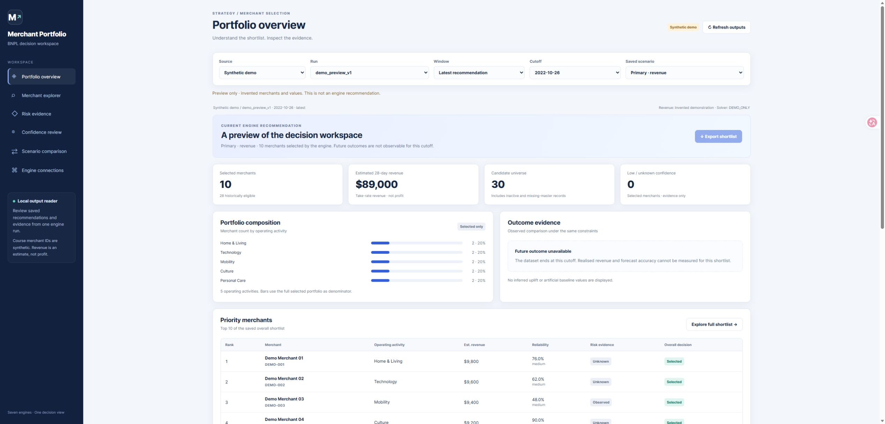
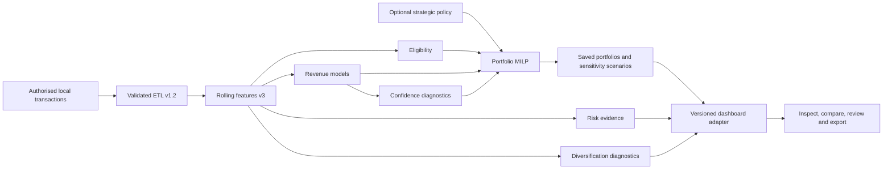

# BNPL Merchant Decision Support

**From 14.2 million transactions to an explainable merchant portfolio.**

[](https://github.com/tqyyds/bnpl-merchant-decision-support/actions/workflows/ci.yml)
[](#run-locally)
[](#try-the-dashboard)

An independently developed applied data science project by **[tqyyds](https://github.com/tqyyds)**. It turns transaction history into an auditable shortlist of up to 100 Buy Now, Pay Later merchants using temporal revenue modelling, explicit eligibility rules, confidence diagnostics and mixed-integer portfolio optimisation.

**[Explore the code](engines/) · [Results and evidence](docs/RESULTS.md) · [Architecture](docs/ARCHITECTURE.md) · [中文说明](README.zh-CN.md)**



## What the project demonstrates

- **Data engineering at scale:** versioned ETL for **14,195,505 transactions**, **499,999 consumers** and **4,422 merchant master records**, with immutable inputs, join checks and source hashes.
- **Leakage-aware modelling:** 90-day history / 28-day target snapshots; six training, three validation and eight held-out test cutoffs; train-only preprocessing and temporal out-of-fold evaluation.
- **Model selection with evidence:** compare run-rate baselines, Ridge, histogram gradient boosting and a three-seed causal TCN. Keep the simpler baseline when the fixed promotion gate is not met.
- **Decision engineering:** binary SciPy MILP for merchant selection, deterministic tie-breaking, capacity constraints and saved sensitivity scenarios; five independent activity-group Top-10 lists.
- **Product delivery:** interactive dashboard with merchant exploration, risk evidence, confidence diagnostics, saved scenario comparison, output integrity checks and controlled CSV export for validated local outputs.

## Results at a glance

These are **historical validation results** from saved run `seven_v1_20260906`, averaged over three validation cutoffs. They are not public-demo values or claims about future production performance.

| Model | NDCG@100 ↑ | Oracle revenue capture@100 ↑ | MAE, AUD ↓ |
|---|---:|---:|---:|
| **90-day run rate — retained** | **0.993859** | 0.995783 | 396.95 |
| 28-day run rate | 0.991358 | 0.994924 | **362.06** |
| Causal TCN, three seeds | 0.990185 | **0.995921** | 390.27 |
| Ridge | 0.988217 | 0.992926 | 587.74 |
| Histogram gradient boosting, Poisson | 0.980913 | 0.993146 | 512.50 |
| Histogram gradient boosting, log target | 0.964724 | 0.994080 | 445.10 |

NDCG measures ranking quality using nonnegative linear revenue gain. Oracle capture compares the realised take-rate revenue of the predicted Top-100 with the hindsight best Top-100 at the same cutoff. These are ranking and revenue-proxy metrics, not classification accuracy or profit. [Inspect the source JSON](reports/portfolio/model_comparison.json).

## Try the dashboard

The public demonstration uses **30 invented merchants**, including a synthetic selected portfolio of 10. It requires only Python's standard library, no private data, API keys or model downloads.

```bash
git clone https://github.com/tqyyds/bnpl-merchant-decision-support.git
cd bnpl-merchant-decision-support
python -m http.server 8767 --bind 127.0.0.1 --directory dashboard
```

Open **[http://127.0.0.1:8767/?demo=1](http://127.0.0.1:8767/?demo=1)**. Use Overview, Explorer, Connections, Risk, Confidence and Scenarios to inspect the product. Demo numbers are visibly labelled synthetic. Saved engine scenario replay and validated CSV export require authorised local engine outputs.

## Architecture



Risk evidence enriches inspection; the saved primary portfolio does not activate a validated expected-loss constraint. Strategic fit remains neutral when no business policy is configured. [Read the component contracts and limitations](docs/ARCHITECTURE.md).

## Run locally

Use Python 3.12+ and Node.js 22+ for the JavaScript checks. The original model-training environment is recorded separately in [runtime.json](reports/portfolio/runtime.json).

```bash
python -m venv .venv
# Windows: .venv\Scripts\activate
# macOS / Linux: source .venv/bin/activate
python -m pip install -r requirements-test.txt
python -m pip install "torch>=2.2,<3" --index-url https://download.pytorch.org/whl/cpu
python -m pytest -q
node --test tests/test_dashboard_client.mjs
python scripts/check_public_release.py
```

The tests use synthetic fixtures. Reproducing course-data ETL and model training requires separately authorised input files; a fresh public clone does not contain them. See [reproduction instructions](docs/REPRODUCING.md).

## Repository guide

| Location | Contents |
|---|---|
| [`src/bnpl_etl/`](src/bnpl_etl/) | Raw-source validation, parsing, cleaning and partitioned outputs |
| [`src/bnpl_analysis/`](src/bnpl_analysis/) | Rolling snapshots, feature quality checks and baseline experiments |
| [`engines/`](engines/) | Eligibility, revenue, confidence, risk, diversification, strategy and portfolio components |
| [`dashboard/`](dashboard/) | Browser UI, synthetic fixture and read-only adapter/server |
| [`notebooks/`](notebooks/) | Audit, EDA, split, feature and evaluation notebook sources; outputs removed |
| [`tests/`](tests/) | Synthetic data, temporal, model, optimiser, adapter and transport checks |
| [`reports/portfolio/`](reports/portfolio/) | Aggregate historical evidence and source provenance |
| [`docs/`](docs/) | Architecture, results, reproduction, data policy and detailed design records |

## Scope and authorship

**Author and portfolio maintainer: tqyyds.** This personal edition presents my independently completed implementation across data preparation, feature engineering, model experimentation, decision engines and dashboard integration. The work originated in the MAST30034 BNPL course setting and was previously stored in a group-named repository. Original source locations and file hashes are retained in [provenance](docs/PROVENANCE.md).

The system estimates next-28-day take-rate income, supports relative prioritisation and requires human review. It does not establish profit, credit losses or real merchant onboarding approval. Confidence calibration is insufficient in parts of the historical run; missing fraud evidence remains unknown. Saved output replay does not certify that the current source tree reproduces every historical model artifact. See [results and limitations](docs/RESULTS.md).

No restricted course archives, consumer/transaction records, merchant recommendation lists, trained model binaries, local credentials or notebook outputs are published. Public reference data is restored from its official source when needed. See [data policy](docs/DATA_POLICY.md).
