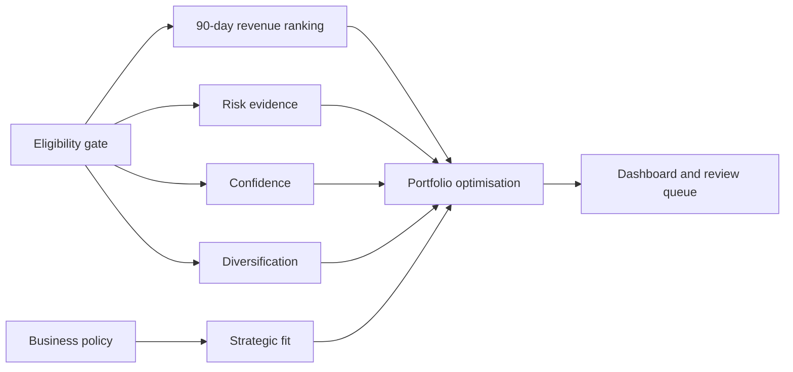

# Historical engine design — superseded

This is the earlier root README, retained verbatim below for provenance. The approved seven-engine protocol supersedes its statuses, training rules and unsupported experiment claims.

# Merchant decision engines

This directory defines the analytical engines behind the BNPL merchant onboarding and portfolio
prioritisation product. The product helps an authorised user decide which merchants to investigate
first. It does **not** automatically approve merchants, and it does not claim to estimate profit or
credit loss from data that are not available.

The design deliberately keeps commercial value, eligibility, risk evidence, evidence confidence,
diversification and business strategy separate. Portfolio optimisation combines their outputs under
visible constraints. This prevents a high revenue estimate from silently cancelling a compliance
failure or missing risk evidence.

## Engine catalogue

| Engine | Current status | Recommended method | Primary output | Decision role |
|---|---|---|---|---|
| Eligibility | Preliminary v1 built | Deterministic rules and registry checks | pass, manual review, unresolved or fail | Determines whether a merchant may enter ranking |
| Revenue | v1 built and validated | **90-day take-rate revenue run-rate** | expected next-28-day revenue proxy and rank | Measures commercial opportunity |
| Risk evidence | Proxy possible; predictive model blocked | Transparent statistical indicators now; calibrated occurrence/severity models after labels arrive | risk evidence, coverage and warnings | Constrains or routes risky cases to review |
| Confidence | Achievable from current coverage fields | Deterministic reliability score plus uncertainty intervals | confidence level and reason codes | Prevents weak evidence from appearing certain |
| Diversification | Category/catchment version achievable | HHI, exposure shares and explicit caps | portfolio exposure coefficients | Prevents excessive concentration |
| Strategic fit | Rules/UI possible; data-defined score blocked | Versioned multi-criteria rules | strategic preference and rationale | Represents current business priorities |
| Portfolio optimisation | Achievable after component contracts | Mixed-integer linear programming | selected portfolio, rank and binding constraints | Chooses at most 100 merchants |

The [engine/data status register](STATUS.md) records which inputs are available, publicly obtainable,
or provider-owned. An engine must not be described as production-ready merely because its algorithm can
be implemented.

## Common input contract

### Decision grain and time boundary

Every modelled record represents one `(merchant_abn, cutoff)` decision. Unless an engine explicitly
states otherwise:

- historical features cover the 90 calendar days ending on `cutoff`;
- the revenue outcome covers the following 28 calendar days;
- `merchant_abn` and `cutoff` are alignment metadata, not predictors;
- preprocessing and feature selection must be fitted on training data only; and
- data that would not have been known by the cutoff must not be used.

The current rolling snapshot contains:

| Split | Cutoffs | Eligible merchant-cutoff rows | Use |
|---|---:|---:|---|
| Train | 6 | 23,537 | Fit models and preprocessing |
| Validation | 3 | 11,872 | Compare development candidates |
| Test | 8 | 31,444 | Protected; do not open during development |

The protected outcome period starts on 2022-02-28. The large number of merchant rows does not replace
the small number of independent dates; model complexity must remain conservative.

### Supplied course inputs

The four restricted ZIP files remain local under `tables/raw/course/` and are never uploaded:

| Source | Grain | Fields used by engines |
|---|---|---|
| Merchant master (`tbl_merchants`) | one merchant | synthetic merchant ABN, category/tags, revenue level and take rate |
| Daily transaction partitions | one order | order ID, merchant ABN, user ID, dollar value and date from partition path |
| Consumer-user mapping | one user-to-consumer mapping | privacy-controlled join between transactions and consumer geography |
| Consumer table | one consumer | state and postcode only; names, address and gender are excluded |
| Consumer fraud probabilities | user × observation date | sparse fraud evidence, recency and coverage; not a realised fraud label |
| Merchant fraud probabilities | merchant × observation date | sparse merchant-level evidence; not a realised fraud label |

The shared rolling feature contract is stored locally under
`tables/modeling/rolling_90d_28d_v2/`. Engine builders copy only their allowed fields into their own
Git-ignored `data/` directories. Labels remain in separate files from predictors.

### External and provider-owned inputs

External data have different roles and must not be mixed indiscriminately:

| Source | Intended use | Restriction |
|---|---|---|
| ABS Census GCP and SEIFA by Postal Area | Customer-catchment context and coverage sensitivity | Area attributes are not individual customer attributes |
| ABS POA boundaries and coding indexes | Geographic aggregation and mapping diagnostics | Customer postcode is not merchant location; do not force postcode to one SA2 |
| ABR bulk extract | Current ABN existence/status and registered attributes | Current snapshots cannot be backfilled into historical cutoffs without dated evidence |
| ASIC company and insolvency records | Entity and dated distress checks | Entity linkage and as-of dates must be validated |
| Provider KYC/AML/compliance data | Final onboarding eligibility | Internal and required for production decisions |
| Chargeback, fraud, default and loss outcomes | Supervised risk modelling | Not supplied; timestamps and dollar severity are required |
| Outreach, acceptance, activation and acquisition cost | Incremental-value and strategic modelling | Not supplied; required to learn whether outreach causes business value |
| Funding, refunds, servicing and merchant costs | Profit modelling | Not supplied; current revenue output must not be called profit |

## 1. Eligibility engine

### Purpose and use

Eligibility is a hard gate. It answers whether a merchant has enough valid information to enter the
commercial ranking and whether external compliance checks are complete. A failed mandatory rule cannot
be offset by high expected revenue.

The current implementation is a retrospective **preliminary** gate. Passing it means “eligible for
analysis, pending external checks,” not “approved for onboarding.”

### Required inputs

| Availability | Dataset/fields | Why required |
|---|---|---|
| Available | Merchant master membership | Confirms the merchant exists in the governed candidate universe |
| Available | `take_rate_pct` | Must be present, finite and positive for the current commercial contract |
| Available | `hist_orders`, `hist_active_days`, `hist_days_since_last_order` | Establishes observable prior activity and detects cold-start cases |
| Public, not integrated | ABR status, entity type, registration dates and registered location | Supports current entity verification |
| Public, not integrated | ASIC company status and dated insolvency appointments | Supports entity and distress checks |
| Provider-owned, missing | KYC, AML, sanctions, prohibited-category, contract and current onboarding status | Required for a final operational eligibility decision |

### Recommended method

Use a deterministic rule engine, not machine learning, for legal, compliance and data-validity rules.
Rules should be versioned, individually named and return reason codes. If historical reviewer outcomes
later become available, a calibrated classifier may prioritise the **manual-review queue**, but it must
not override mandatory compliance rules.

### Output contract

- `historical_model_eligible`: whether the row may enter retrospective modelling;
- `local_rule_reasons`: exact pass/fail reasons;
- `onboarding_eligibility_status`: preliminary pass, fail, unresolved or external checks pending;
- `final_onboarding_eligible`: null until all authoritative checks are available; and
- an unresolved merchant queue for transaction ABNs missing from the merchant master.

### Local usage

```powershell
python engines/eligibility/scripts/build_dataset.py
```

See [eligibility/README.md](eligibility/README.md) for the implemented v1 contract.

## 2. Revenue engine

### Purpose and use

The revenue engine ranks eligible merchants by expected commercial value over the next 28 days. The
available target is take-rate revenue:

```text
next-28-day take-rate revenue = next-28-day GMV × contractual take-rate percentage
```

This is a revenue proxy, not profit, lifetime value or incremental benefit from onboarding.

### Required inputs

The engine-specific feature file contains 30 commercial fields and excludes fraud, geography, PII,
eligibility outcomes and strategic preferences.

| Family | Required fields |
|---|---|
| Merchant terms | `merchant_category`, `revenue_level`, `take_rate_pct` |
| Scale | `hist_gmv`, `hist_orders`, `hist_unique_customers`, `hist_revenue_proxy` |
| Order value | `hist_aov`, amount median/standard deviation/CV, high-value shares |
| Engagement | repeat-customer rate, orders per customer and customer HHI |
| Activity and stability | active days/rate, daily GMV CV, GMV per active day and recency |
| Momentum | last-7-day, last-28-day, previous-28-day GMV and 28-day growth |
| Numerical transforms | log-GMV, log-orders, log-customers and log-revenue proxy |
| Training label only | `target_revenue` from the next 28 days; stored separately |

Local files are under `engines/revenue/data/revenue_v1/`:

- `train_tabular_features.parquet` and `train_labels.parquet`;
- `validation_tabular_features.parquet` and `validation_labels.parquet`; and
- no test file is read by the development scripts.

### Selected model: retain the 90-day run-rate

The production candidate remains the transparent 90-day run-rate:

```text
predicted next-28-day revenue
  = historical 90-day take-rate revenue × 28 / 90
```

Validation evidence:

| Metric | 90-day run-rate |
|---|---:|
| Mean NDCG@100 | 0.993859 |
| Mean oracle revenue capture@100 | 0.995783 |
| Mean Spearman correlation | 0.924474 |
| Mean MAE | AUD 396.95 |
| Consecutive top-100 Jaccard stability | 0.990099 |

The LightGBM LambdaMART experiment remains a challenger only. It uses cutoff dates as query groups and
starts from the log 90-day score, but the training-only selector assigned the model a blend weight of
zero. It therefore produced no validated improvement and must not replace the run-rate.

### Output contract

- `predicted_revenue`: next-28-day take-rate revenue estimate in AUD;
- `revenue_rank`: descending rank among eligible merchants at the cutoff;
- `revenue_percentile`: relative position for combination with non-currency engines;
- `model_version`, `cutoff`, history window and data-quality flags; and
- commercial reason codes such as high historical revenue, stable activity or recent momentum.

### Local usage

```powershell
python engines/revenue/scripts/build_dataset.py
python engines/revenue/scripts/run_engine.py
python engines/revenue/scripts/train_lambdamart.py
```

The first two commands reproduce the selected run-rate. The third is a development challenger and does
not change the champion automatically. See [revenue/README.md](revenue/README.md).

## 3. Risk-evidence engine

### Purpose and use

This engine identifies historical warning evidence and missing risk coverage. It cannot currently
predict fraud loss, default or chargebacks because the supplied probabilities are sparse observations,
not realised outcomes.

### Required inputs

| Availability | Dataset/fields | Treatment |
|---|---|---|
| Available | Consumer fraud probability summaries: mean, maximum, latest, entity-days, coverage, recency and missing flag | Aggregate once per distinct merchant-user-day exposure |
| Available | Merchant fraud probability summaries: mean, maximum, latest, signal days, calendar coverage, recency and missing flag | Preserve native merchant-day grain |
| Available | Customer HHI, daily GMV CV, amount CV, high-value order/GMV shares and recency | Use as operational warning evidence, not proof of fraud |
| Missing | Confirmed fraud, chargeback, default and dollar-loss outcomes | Required for supervised risk prediction |
| Missing | Investigation decisions and event availability timestamps | Required for honest backtesting and workflow learning |

### Recommended method now

Use a transparent statistical evidence index with separate components:

1. convert each available warning measure to a within-cutoff percentile;
2. retain consumer-signal and merchant-signal coverage as separate fields;
3. apply empirical-Bayes shrinkage so a few observations do not create an extreme score;
4. combine components using versioned, governance-approved weights; and
5. return `unknown` or `manual_review` when evidence is too sparse.

Missing probabilities must not be filled with zero and interpreted as low risk.

### Recommended method after outcome data arrive

Use a two-part expected-loss model:

- a calibrated logistic or gradient-boosted classifier for adverse-event occurrence; and
- a Gamma/Tweedie severity model for loss conditional on an event.

Then calculate `expected_loss = event_probability × expected_severity`. Use out-of-time calibration,
precision/recall, Brier score and realised portfolio loss—not accuracy alone. Until those labels exist,
the output must remain `risk_evidence`, not `predicted_loss`.

### Output contract

- consumer-signal evidence and merchant-signal evidence kept separately;
- `risk_evidence_percentile` and component percentiles;
- coverage, observation count, latest observation date and recency;
- warnings and manual-review reasons; and
- no currency-valued expected loss until severity labels are available.

## 4. Confidence engine

### Purpose and use

Confidence measures how much evidence supports each engine output. It is not the inverse of risk. A
merchant can have attractive revenue, low observed warning evidence and still have low confidence
because history or fraud coverage is sparse.

### Required inputs

- historical orders, active days, unique customers and history completeness;
- consumer- and merchant-signal entity counts, calendar coverage, recency and missingness;
- registry match status, source vintage and unresolved-join flags when integrated;
- model disagreement and prediction interval width when multiple valid models exist; and
- production drift, missing-feature and data-freshness indicators when deployed.

### Recommended method

Use a deterministic statistical reliability score rather than a supervised ML model. Scale volume,
coverage, recency and join quality to `[0, 1]`, cap the benefit of very large sample counts, and combine
the dimensions with a weighted geometric mean. A geometric mean ensures that one critically weak
dimension cannot be hidden by strong values elsewhere.

For revenue uncertainty, add bootstrap or conformal prediction intervals once enough independent cutoff
dates exist. Keep interval width separate from the coverage score.

### Output contract

- `confidence_score` in `[0, 1]`;
- confidence band: high, medium, low or unresolved;
- component scores for history, fraud evidence, registry and freshness;
- uncertainty interval where statistically supportable; and
- reason codes identifying the weakest evidence dimension.

Confidence should determine whether a merchant is automatically prioritised, sent to manual review or
kept unresolved. It should not directly pretend to increase or decrease expected revenue.

## 5. Diversification engine

### Purpose and use

Diversification describes portfolio exposure and supplies constraints to the optimiser. It prevents a
top-100 list from becoming concentrated in one category or one observed customer catchment.

### Required inputs

| Availability | Dataset/fields | Valid interpretation |
|---|---|---|
| Available | `merchant_category`, merchant revenue/value score | Merchant-category exposure |
| Available | Transaction user IDs joined through the user-consumer map to state/postcode | Observed customer-catchment exposure |
| Available externally | ABS POA boundaries, Census GCP and SEIFA | Area-level catchment context only |
| Public, not integrated | ABR registered state/postcode | Current registered merchant geography, subject to as-of limitations |
| Missing | Historical merchant operating locations and provider-approved exposure limits | Required for historical location constraints and production policy |

### Recommended method

Use descriptive statistics and mathematical constraints, not predictive ML:

- category and catchment revenue shares;
- Herfindahl-Hirschman Index (HHI);
- Shannon entropy or effective number of categories;
- largest-category and largest-region exposure; and
- marginal concentration change if a merchant is added.

Optional clustering may help users explore similar merchants, but a cluster ID should not determine
approval. Customer postcode describes where observed customers live; it must never be presented as the
merchant's physical location.

### Output contract

- merchant category and catchment exposure vector;
- category/catchment HHI contributions;
- portfolio share coefficients used by the optimiser;
- concentration warnings; and
- geography coverage and interpretation flags.

## 6. Strategic-fit engine

### Purpose and use

Strategic fit represents explicit, current business preferences—for example a category growth campaign,
partnership capacity or a temporary exclusion. It must not be inferred from revenue or risk and then
presented as business strategy.

### Required inputs

The supplied data provide only merchant category and revenue level. A defensible strategic score also
requires provider-owned inputs:

- target and excluded categories;
- desired merchant tiers and regional priorities;
- existing partnership and outreach status;
- sales-team capacity and acquisition cost;
- contractual or campaign priorities;
- strategic effective dates, owner and approval record; and
- historical outreach, acceptance and activation outcomes for any learned model.

### Recommended method

Use a versioned multi-criteria decision analysis (MCDA) or rule table. Each policy supplies an effective
date, weight, cap or exclusion and a human-readable reason. The scenario builder may change these values
without retraining the revenue model.

Do not train a strategic-fit model from the current course data: there is no target that represents
provider strategy. If outreach and activation outcomes later exist, estimate incremental impact with a
causal/uplift model rather than simply predicting which already-large merchants accepted outreach.

### Output contract

- `strategic_fit_score` and scenario version;
- policy bonuses, exclusions and capacity consumption;
- positive and negative reason codes; and
- `manual_override` with owner, timestamp and rationale in production.

## 7. Portfolio-optimisation engine

### Purpose and use

This engine makes the discrete portfolio decision after all other engines have produced their outputs.
It does not learn merchant quality. It selects the best feasible set under capacity, eligibility, risk,
confidence and concentration rules.

### Required inputs

| Upstream engine/policy | Required field |
|---|---|
| Eligibility | allowed, manual-review or unresolved status |
| Revenue | 90-day run-rate revenue estimate, rank and percentile |
| Risk evidence | evidence percentile, coverage and warnings |
| Confidence | score/band and unresolved flags |
| Diversification | category/catchment membership and concentration coefficients |
| Strategic fit | scenario-specific score, exclusions and capacity costs |
| Business policy | portfolio capacity, category caps, risk appetite and review capacity |

### Recommended method

Use mixed-integer linear programming with one binary decision variable `x_i` per merchant. A practical
first objective is:

```text
maximise Σ x_i × (expected take-rate revenue_i + approved strategic bonus_i)
```

subject to:

```text
Σ x_i ≤ 100
x_i = 0 for ineligible merchants
category and catchment shares ≤ configured caps
average/total risk evidence ≤ configured limit
low-confidence selections ≤ manual-review capacity
mandatory strategic exclusions are satisfied
```

Use OR-Tools, PuLP or SciPy MILP and return the solver status. Because current risk evidence is not
calibrated in dollars, it should initially act as a constraint or review trigger—not be subtracted from
revenue as if it were expected monetary loss. Once expected loss and operating costs are available, the
objective can move to expected risk-adjusted contribution.

### Output contract

- `portfolio_selected` and `portfolio_rank`;
- selected revenue total and component exposure summaries;
- binding constraints and unused capacity;
- reason each non-selected merchant was excluded or fell below the capacity boundary;
- alternative portfolios for approved scenarios; and
- solver, policy and upstream-engine versions for reproducibility.

## Execution order



At a decision cutoff:

1. run source validation and construct point-in-time merchant features;
2. apply the eligibility gate and retain unresolved merchants separately;
3. calculate the 90-day revenue run-rate for eligible merchants;
4. calculate risk evidence, confidence and diversification components without mixing their meanings;
5. load an approved strategic-policy scenario;
6. solve the capacity-constrained portfolio problem; and
7. publish merchant decision cards, aggregate portfolio metrics and reason codes to the dashboard.

## Model-selection and governance rules

- The 90-day run-rate remains the revenue champion until a challenger produces a material, consistent
  out-of-time improvement in NDCG@100 and realised top-100 revenue capture.
- LambdaMART, Boruta or another feature-selection/model experiment must run inside training data and
  cannot automatically replace a selected contract.
- Do not use consumer names, street addresses, gender or raw transaction rows in engine outputs.
- Do not convert missing fraud evidence into zero risk.
- Do not call customer catchment merchant location.
- Do not call take-rate revenue profit.
- Do not use current public registry attributes at historical cutoffs unless historical availability is
  demonstrable.
- Keep test outcomes sealed until the engine contracts, metrics and promotion rules are independently
  reviewed and frozen.
- Every output must include data cutoff, engine version, policy version and reason codes.

## Repository and publication boundary

Code, aggregate reports and synthetic dashboard examples may be committed. Course ZIPs, extracted source
tables, merchant-level feature/label files, predictions, rankings and model artefacts remain local and
Git-ignored. Planned engines should follow this structure when implemented:

```text
engines/<engine_name>/
  README.md
  config.json
  pipeline.py
  scripts/
  data/       # local and Git-ignored
  reports/    # aggregate evidence only
```

The dashboard consumes governed merchant-level engine outputs in the restricted runtime; it must never
embed them in the public repository.
