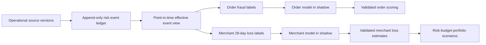

# Risk label and loss contract

> Project status: the project will not receive the final-adjudication fraud and Finance loss sources
> required by this document. This remains a non-executable reference contract. The implemented
> course-only proxy path is documented in `course_fraud_proxy_gam.md` and never satisfies this
> production contract.

**Status:** Conditional approval. R1-R3 now have an offline contract implementation and synthetic
tests, but this document is not evidence that production labels, loss models, or activated
risk-budget portfolio constraints exist.

The architecture is approved only at the design level. Production activation must not begin until
the operational source owners, Finance, Risk, and Model Governance approve the event semantics,
loss-deduplication priority, maturity threshold, source coverage rules, validation thresholds, and
portfolio budgets described below.

## 1. Current Project Contract

The MAST30034 data support merchant, transaction, consumer, and sparse daily fraud-probability
records. They do **not** provide a complete operational chargeback ledger, credit write-offs,
recoveries, final fraud adjudications, or Finance reconciliation totals.

Consequently, the current implementation remains:

```text
risk_status = EVIDENCE_ONLY_NO_LOSS_LABELS
```

The existing `fraud_probability` values are historical observations at user-day or merchant-day
grain. They may be displayed as evidence, with coverage and recency, but they are not confirmed
fraud outcomes and must never be converted into supervised fraud or loss labels. The current
`composite_risk_score` and `predicted_loss_aud` therefore remain null. Existing nullable review
prompts remain evidence-only and missing evidence never means zero risk.

The implementation remains opt-in and does not alter the Revenue model, current recommendations,
engine runtime states, or frozen artefacts. The portfolio optimiser accepts future risk constraints
only when an explicit validated policy and a complete consistent prediction universe are supplied;
existing calls are unchanged.

## 2. Future Production Contract

The future system has two separately governed prediction paths:

1. **Order fraud:** at the payment-authorisation decision point, estimate
   `probability_of_eventual_confirmed_fraud` for the order.
2. **Merchant loss:** at a merchant portfolio cutoff, estimate the merchant's next-28-day net loss
   amount and net loss rate from information available at that cutoff.

The merchant target is built directly from a future order cohort. It is not reconstructed by
aggregating scores for future orders that were unknowable at the merchant cutoff.



### Delivery phases

```text
R0  Current evidence-only engine
R1  Operational-event accounting contract
R2  Point-in-time mature label generation
R3  Label QA and empirical maturity validation
R4  Order and merchant models in SHADOW
R5  Protected temporal validation and test
R6  VALIDATED
R7  Portfolio risk-budget scenarios
```

The repository now contains the R1 contract plus offline R2/R3 builders, quality gates, tests, and
the fail-closed `scripts/build_risk_labels.py` release command. The checked-in
`config/risk_label_contract_v1.json` intentionally contains null governance decisions and cannot
run until authorised owners supply them in a reviewed configuration.
Running R2/R3 against real data and every activity in R4-R7 still require approved operational data.

The release command also requires a hashed maturity-validation snapshot containing measured
90/120/150-day adjustment rates. It independently selects the first passing window and requires it
to equal the configured approved window. Finance reconciliation is recomputed from operational and
Finance net-loss totals using an approved absolute and/or relative tolerance; a caller-supplied
`PASS` string is not accepted as evidence.

## 3. Operational event accounting

### 3.1 `operational_risk_events`

This is an append-only accounting ledger. Corrections are new versions or explicit reversals;
source rows are never overwritten in place.

| Field | Contract |
|---|---|
| `event_id` | Globally unique immutable event-version identifier |
| `source_system` | Controlled source-system identifier |
| `source_record_id` | Stable business record identifier in the source |
| `revision` | Monotonically increasing source revision for the record |
| `supersedes_event_id` | Prior event version explicitly superseded, nullable for the first version |
| `original_loss_event_id` | Originating loss event for a reversal or recovery, when applicable |
| `loss_case_id` | Stable economic-loss case identifier |
| `loss_component_id` | Stable identifier for one economic amount within the case |
| `order_id` | Stable order key used for cohort attribution |
| `merchant_abn` | Canonical merchant key carried from the linked order |
| `event_type` | Controlled accounting event type |
| `case_status` | Controlled investigation/adjudication state |
| `occurred_at` | Business-effective timestamp |
| `available_at` | First timestamp this exact version was available to the analytical system |
| `amount_aud` | Finite non-negative AUD amount for monetary event types |

Required uniqueness constraints are:

```text
event_id                                      UNIQUE
(source_system, source_record_id, revision)  UNIQUE
```

Minimum monetary `event_type` values are:

```text
FRAUD_LOSS
FRAUD_LOSS_REVERSAL
CREDIT_WRITE_OFF
CREDIT_WRITE_OFF_REVERSAL
FEE
RECOVERY
```

Source systems may supply signed reversals, but the curated layer converts them into explicit event
types with non-negative amounts. Label outputs also expose non-negative `gross_fraud_loss_aud`,
`gross_credit_loss_aud`, `fees_aud`, and `recoveries_aud` components.
An ordinary commercial refund is not a recovery unless it is explicitly linked to a governed loss
case and its originating loss event.

### 3.2 Point-in-time effective version

For `label_as_of = T`, the label builder must:

1. filter to `available_at <= T`;
2. group by `(source_system, source_record_id)`;
3. resolve the explicit supersession and reversal chain;
4. retain exactly one effective accounting state; and
5. quarantine missing links, cycles, competing terminal versions, or unresolved conflicts.

Selecting the numerically largest revision without validating the chain is prohibited. The builder
must retain enough lineage to reproduce every effective event from the append-only source.

### 3.3 Economic-loss deduplication

One economic loss amount may contribute to no more than one gross-loss component. The accounting
owner must approve a versioned classification policy before R2. Its required invariant is:

```text
one (loss_case_id, loss_component_id, amount)
does not contribute to both gross_fraud_loss_aud and gross_credit_loss_aud
```

The default policy shape, pending owner approval, is that confirmed fraud principal overrides an
overlapping credit-principal classification. Non-overlapping fees remain separately countable.
Recoveries offset their originating loss case. Models may not infer or change this priority.

### 3.4 Cohort attribution

Every loss, reversal, fee, and recovery is attributed through `order_id` and `loss_case_id` to the
original order cohort. Posting date never moves an adjustment into a later merchant cohort.

For example, an April recovery linked to a January order reduces the January order cohort's loss.
Unlinked recoveries are quarantined; they are not allocated proportionally or assigned to the
posting month.

## 4. Label maturity and point-in-time rules

The initial candidate maturity window is 90 days, but 90 days is not automatically approved.

```text
maturity_window_days = 90
max_post_maturity_adjustment_rate = <risk-owner-approved value>
```

For each historical label snapshot:

$$
post\_90d\_adjustment\_rate =
\frac{\#\{labels\ declared\ mature\ at\ 90d\ that\ later\ changed\}}
{\#\{labels\ declared\ mature\ at\ 90d\}}
$$

Risk must approve `max_post_maturity_adjustment_rate` before protected test labels are opened. If
the observed rate exceeds it, the builder increases the candidate window from 90 to 120 and then
150 days and reruns maturity analysis. If no candidate window passes, the system enters
`DEGRADED_LABEL_QUALITY` and must not train, validate, or serve decisioning loss predictions.

A label window is eligible only when:

```text
label_end + maturity_window_days <= data_as_of
source_coverage_complete = true
label_quality_status = PASS
```

The minimum history requirement is **18 months of mature labels**, not 18 months of raw data. With
a 90-day historical feature window and a 90-day maturity wait, approximately 24 months of raw
coverage may be required.

Every feature used by a model must satisfy `feature.available_at <= scored_at`. Every label build
must satisfy `event.available_at <= label_as_of`. Backfills and late adjustments create new label
versions; they never rewrite a frozen training input.

## 5. Order fraud labels

### 5.1 Decision time

`scored_at` is `payment_authorisation_requested_at`, or the equivalent timestamp at which the
operational system can still approve or reject the transaction. It is not assumed to equal
`order_created_at`.

Historical fraud-model probabilities are eligible as features only when `generated_at`,
`model_version`, and `feature_snapshot_as_of` are available and prove `generated_at <= scored_at`.
The producing model must itself be point-in-time compliant. Otherwise:

```text
historical_fraud_probability_feature_eligible = false
```

### 5.2 `order_fraud_labels`

The table grain is one row per `(order_id, label_version)`.

| Field | Meaning |
|---|---|
| `order_id`, `merchant_abn` | Stable alignment keys |
| `order_created_at`, `scored_at` | Order creation and actual decision timestamps |
| `label_as_of`, `label_generated_at`, `data_as_of` | Point-in-time and build audit timestamps |
| `observation_end`, `maturity_at` | Outcome observation boundary and approved maturity boundary |
| `fraud_label` | Nullable Boolean eventual-confirmed-fraud target |
| `label_status`, `label_reason_code` | Controlled state and deterministic reason |
| `confirmed_at` | Final positive adjudication timestamp, nullable |
| `source_coverage_complete` | Whether every required adjudication source is complete |
| `required_sources`, `missing_sources`, `coverage_snapshot_id` | Coverage evidence |
| `order_match_status` | Exact order-link outcome; fuzzy matches are prohibited |
| `label_version` | Immutable logical label release |
| `source_snapshot_hash`, `label_code_version`, `label_config_hash` | Reproduction evidence |

Label rules are:

- `fraud_label = true` only for an effective, final confirmed-fraud adjudication.
- `fraud_label = false` only after maturity, complete required-source coverage, and no effective
  confirmed fraud outcome.
- Open, disputed, unmatched, coverage-incomplete, or otherwise unresolved cases remain null.
- Training extracts include only mature, quality-passing labels. An early confirmed positive may be
  visible operationally but does not permit contemporaneous immature negatives into training.
- A later reversal creates a new label version with lineage; the earlier release remains reproducible.

The model output name is:

```text
probability_of_eventual_confirmed_fraud
```

It estimates eventual confirmation conditional on features available at `scored_at`; it is not the
probability that fraud has already been confirmed.

## 6. Merchant loss labels

### 6.1 Cohort definition

For merchant cutoff `C`:

```text
label_start = C + 1 day
label_end   = C + 28 days
maturity_at = label_end + approved maturity_window_days
```

The builder receives the eligible merchant snapshot universe explicitly. It must not derive the
universe from future orders; merchants with zero future orders remain as zero-exposure label rows.

`future_gmv_aud` is the gross authorised purchase amount for eligible orders whose authorisation
time falls in `[label_start, label_end]`, before later loss-accounting adjustments. Any future move
to settled GMV requires a new label-contract version and consistent migration of all denominators.

The component formula is:

$$
net\_loss\_aud = gross\_fraud\_loss\_aud + gross\_credit\_loss\_aud + fees\_aud - recoveries\_aud
$$

Components are non-negative. A negative resulting net loss is not clipped: it receives
`label_status = QUARANTINED` and is sent to the accounting exception queue.

### 6.2 `merchant_loss_labels`

The table grain is one row per `(merchant_abn, cutoff, label_version)`.

| Field | Meaning |
|---|---|
| `merchant_abn`, `cutoff` | Merchant snapshot key |
| `label_start`, `label_end`, `maturity_at` | Inclusive cohort and maturity boundaries |
| `label_generated_at`, `label_as_of`, `data_as_of`, `observation_end` | Build-time audit boundaries |
| `is_mature`, `label_status`, `label_reason_code` | Usability state and reason |
| `future_orders`, `future_gmv_aud` | Cohort exposure |
| `confirmed_fraud_orders`, `fraud_rate` | Confirmed order outcomes and order-count rate |
| `gross_fraud_loss_aud`, `gross_credit_loss_aud`, `fees_aud`, `recoveries_aud` | Non-negative accounting components |
| `net_loss_aud`, `net_loss_rate` | Net monetary target and nullable rate |
| `denominator_status` | Explicit interpretation of the GMV denominator |
| `currency` | Must be `AUD` for this contract |
| `source_coverage_complete` | Required-source completeness at `label_as_of` |
| `required_sources`, `missing_sources`, `coverage_snapshot_id` | Coverage evidence |
| `reconciliation_status` | Finance reconciliation result |
| `label_version` | Immutable logical label release |
| `source_snapshot_hash`, `label_code_version`, `label_config_hash` | Reproduction evidence |

Denominator rules are frozen as follows:

| Condition | Required result |
|---|---|
| `future_orders = 0`, `future_gmv_aud = 0`, `net_loss_aud = 0` | `net_loss_rate = null`; `denominator_status = NO_FUTURE_GMV` |
| `future_gmv_aud > 0` | `net_loss_rate = net_loss_aud / future_gmv_aud`; `denominator_status = VALID` |
| `future_gmv_aud = 0`, `net_loss_aud > 0` | `net_loss_rate = null`; `denominator_status = INVALID_ZERO_GMV_WITH_LOSS`; label quarantined |

No missing or undefined rate is filled with zero or infinity.

## 7. Label quality and reconciliation gates

The following are hard failures:

- duplicate `event_id`, event version key, or label release key;
- an invalid or cyclic supersession/reversal chain;
- competing final adjudication states;
- missing required partitions for a label declared mature;
- join row multiplication or a non-exact order match;
- invalid currency, non-finite amount, or negative curated component;
- duplicate economic-loss attribution across fraud and credit components;
- recovery not linked to its originating loss case and cohort;
- negative net loss or positive loss with a zero GMV denominator; or
- Finance reconciliation outside an owner-approved, versioned tolerance.

Orphan events and unresolved cases are quarantined, never deleted or fuzzily matched. Every label
release reports by date and source: exact order-link coverage, missing-source coverage, label rate,
adjudication latency, post-maturity adjustment rate, quarantine counts, and Finance reconciliation.

The source owner defines source-completeness service levels. Finance defines reconciliation
tolerances as an approved maximum absolute AUD difference, maximum relative difference, or both.
Risk defines the acceptable post-maturity adjustment rate. None receive invented code defaults;
absent approval keeps the engine out of `VALIDATED`.

## 8. Temporal development protocol

Use at least 18 months of mature labels. Anchor the schedule on the latest 28-day label window that
passes all quality gates and whose maturity boundary is on or before `data_as_of`.

- last three non-overlapping 28-day windows: protected test;
- preceding three non-overlapping 28-day windows: validation;
- all earlier eligible windows: training and temporal out-of-fold development.

Feature preprocessing, feature selection, model selection, label policies, thresholds, and tie
breaks are fixed using training and validation only. Prediction files and their hashes are locked
before protected test labels are opened. Each validation and test window is reported separately,
followed by pooled and mean summaries.

Before protected test, Risk and Model Governance must preregister non-null thresholds in a
versioned policy equivalent to:

```yaml
order_fraud_validation:
  min_pr_auc: <approved>
  min_recall_at_capacity: <approved>
  max_brier_score: <approved>
  max_calibration_error: <approved>

merchant_loss_validation:
  max_mae_aud: <approved>
  max_aggregate_bias_pct: <approved>
  min_top_k_loss_capture: <approved>

portfolio_validation:
  max_realised_budget_breach_rate: <approved>
```

Order-model reporting includes PR-AUC, recall at investigation capacity, Brier score, calibration
error, and temporal/segment stability. Merchant-model reporting includes loss MAE, aggregate bias,
Top-K loss capture, temporal stability, and portfolio budget-breach rate. No metric may be described
as passed until its preregistered threshold exists and passes on the protected evaluation.

## 9. Risk engine state machine

The target production contract adds a label-quality and model-quality distinction:

| Target state | Loss prediction | Portfolio hard risk constraint |
|---|---:|---:|
| `EVIDENCE_ONLY_NO_MATURE_LABELS` | No | OFF |
| `SHADOW` | Yes, non-decisioning | OFF |
| `VALIDATED` | Yes | ON when an approved budget is configured |
| `DEGRADED_LABEL_QUALITY` | Not trusted | OFF |
| `DEGRADED_MODEL_QUALITY` | Not trusted | OFF |

All non-`VALIDATED` states continue to expose historical risk evidence, nullable manual-review
hints, state, and reason codes. They do not silently reuse stale trusted predictions. The current
runtime string remains `EVIDENCE_ONLY_NO_LOSS_LABELS` until a later code change explicitly migrates
it to the target state machine.

Transitions require:

- `EVIDENCE_ONLY_NO_MATURE_LABELS -> SHADOW`: complete mature labels, passing label QA, trained
  versioned models, and preregistered acceptance policy;
- `SHADOW -> VALIDATED`: all protected validation/test and governance gates pass;
- any trusted state -> `DEGRADED_LABEL_QUALITY`: freshness, maturity, linkage, deduplication, or
  reconciliation gate fails;
- `VALIDATED -> DEGRADED_MODEL_QUALITY`: monitored calibration, discrimination, bias, or stability
  breaches the approved policy.

Recovery requires a new passing label/model release; an operator cannot manually relabel a failed
run as validated.

## 10. Risk outputs

### Order output

```text
order_id
scored_at
probability_of_eventual_confirmed_fraud
risk_state
risk_reason_codes
model_version
label_version
feature_snapshot_as_of
prediction_generated_at
```

### Merchant output

```text
merchant_abn
cutoff
predicted_net_loss_28d_aud
predicted_net_loss_28d_p95_aud
predicted_loss_rate_28d
predicted_future_gmv_28d_aud
risk_state
risk_reason_codes
model_version
label_version
prediction_as_of
prediction_generated_at
```

Expected and conservative scenarios have different names and interpretations:

- `EXPECTED_LOSS` uses the conditional mean `predicted_net_loss_28d_aud`.
- `CONSERVATIVE_LOSS_P95` uses `predicted_net_loss_28d_p95_aud`.

Satisfying either budget does not guarantee realised loss will remain below that budget.

## 11. Portfolio mathematical contract

Let `x_i` be the binary decision to select merchant `i`, `L_i` the scenario-specific predicted loss,
`G_i` the predicted 28-day gross authorised GMV, `B_L` the approved loss budget, and `r_max` the
approved portfolio loss-rate limit.

Expected-loss amount constraint:

$$
\sum_i x_i L_i \le B_L
$$

Portfolio expected-loss-rate constraint:

$$
\sum_i x_i L_i \le r_{max}\sum_i x_i G_i
$$

The rate constraint uses the ratio of portfolio totals, never an unweighted or simple average of
merchant loss rates. Selected predicted GMV must be positive.

Policy fields are:

```text
loss_scenario = EXPECTED_LOSS | CONSERVATIVE_LOSS_P95
max_total_expected_net_loss_aud = <risk-owner-approved or null>
max_expected_loss_rate = <risk-owner-approved or null>
```

At least one budget must be configured for a risk-constrained scenario. There is no default budget.
Before optimisation, every candidate must have finite, non-null loss and GMV predictions with the
same risk-model version, label version, scenario, and prediction as-of timestamp. Missing values
must not be filled with zero.

```text
risk_state != VALIDATED or inconsistent/missing inputs
    -> scenario_status = INVALID_RISK_INPUTS

approved constraints have no feasible portfolio
    -> scenario_status = INFEASIBLE
```

The optimiser must not increase a budget, drop a candidate silently, or switch from conservative to
expected loss to manufacture feasibility.

## 12. Acceptance scenarios

Future implementation tests must cover at least:

1. final confirmed fraud creates a positive order label;
2. a mature, fully covered order with no fraud creates a negative label;
3. an immature, disputed, incomplete, or unmatched order remains null;
4. a later reversal creates a new reproducible label version;
5. event versions resolve only through a valid supersession chain;
6. competing terminal revisions are quarantined instead of selecting the largest revision;
7. overlapping credit and fraud principal is counted once under the approved priority;
8. a recovery reduces the original order cohort, not its posting-date cohort;
9. negative net loss is quarantined rather than clipped;
10. no-future-GMV rows produce a null loss rate and explicit denominator status;
11. positive loss with zero GMV is quarantined;
12. `available_at` and `scored_at` mutations cannot leak future information;
13. the 90/120/150-day maturity analysis follows the approved adjustment-rate gate;
14. label releases reproduce from their source, code, and configuration hashes;
15. each validation/test window is reported before pooled summaries;
16. non-`VALIDATED` states disable hard risk constraints but retain evidence displays;
17. inconsistent risk inputs fail closed with `INVALID_RISK_INPUTS`; and
18. an infeasible approved budget returns `INFEASIBLE` without policy relaxation.

## 13. Ownership and approvals

| Decision | Required owner |
|---|---|
| Fraud final-state semantics and investigation capacity | Fraud Operations / Risk |
| Fraud-versus-credit loss priority and case/component identifiers | Finance and Risk |
| GMV exposure definition and eligible-order policy | Finance and Product |
| Source coverage, latency, and completeness declaration | Operational source owner |
| Reconciliation tolerance | Finance |
| Maturity adjustment threshold | Risk |
| Model acceptance thresholds | Risk and Model Governance |
| Portfolio loss amount/rate budgets | Authorised Risk owner |

Until these approvals are stored in versioned configuration, the production contract is not
decisioning-ready and the current evidence-only behavior remains the only supported behavior.
