# Conceptual end-to-end pipeline

## Business question

Which merchants should the BNPL provider prioritise for partnership outreach, subject to limited
team capacity and an explicit risk appetite?

The unit of decision is one merchant. The product produces a portfolio recommendation and evidence
for human review; it does not automatically approve a contract.

## Architecture

```mermaid
flowchart TD
    subgraph S[1. Source layer — local/restricted]
        S1[Merchant master]
        S2[Daily transactions]
        S3[Consumer-user map]
        S4[Consumer and merchant fraud observations]
        S5[ABS Postal Area context]
    end

    subgraph Q[2. Quality and governance gate]
        Q1[Schema and date checks]
        Q2[Duplicate and join diagnostics]
        Q3[PII exclusion]
        Q4[Coverage report]
    end

    subgraph C[3. Curated analytical layer]
        C1[Clean merchant dimension]
        C2[Privacy-minimised transaction fact]
        C3[Historical merchant feature table]
        C4[Later merchant outcome table]
    end

    subgraph M[4. Analytical layer]
        M1[Future take-rate revenue model]
        M2[Risk indicators]
        M3[Evidence confidence]
        M4[Boruta sensitivity experiment]
        M5[Out-of-time validation and baselines]
    end

    subgraph D[5. Decision layer]
        D1[Risk-adjusted opportunity]
        D2[Capacity and industry constraints]
        D3[Recommendation and reason codes]
    end

    subgraph U[6. Product and feedback]
        U1[Executive dashboard]
        U2[Merchant decision card]
        U3[Scenario builder]
        U4[Review/export queue]
        U5[Outcome monitoring]
    end

    S --> Q --> C
    C1 --> C3
    C2 --> C3
    C2 --> C4
    C3 --> M1
    C3 --> M2
    C3 --> M3
    C3 --> M4
    C4 --> M5
    M1 --> M5
    M4 --> M5
    M1 --> D1
    M2 --> D1
    M3 --> D1
    D1 --> D2 --> D3
    D3 --> U1
    D3 --> U2
    D3 --> U3
    D3 --> U4
    U5 -. informs refresh .-> M
```



## Stage-by-stage design

### 1. Ingest locally and register provenance

Keep the four supplied ZIPs outside version control. Record archive names, file counts, hashes,
schema versions, and observation dates in a local run manifest. Public external files may be
versioned separately, but their source and vintage must be documented.

**Output:** a run manifest and pointers to local source files—not copied source data.

### 2. Apply a data-quality and privacy gate

Check expected schemas, date ranges, unique order identifiers, ABN formats, user/consumer joins,
merchant-tag parsing, and fraud-key duplicates. Report transaction-only ABNs separately. Exclude
consumer name, street address, and gender from the analytical layer because they are not needed for
the business decision.

**Output:** a quality report with pass/warn/fail status and a privacy-minimised transaction view.

### 3. Define the candidate universe and time split

Use the 4,026 merchant-master records as the auditable candidate universe, but build supervised
examples at `(merchant_abn, cutoff)` grain. A merchant is eligible for model fitting and ranking
only when it has at least one order in the feature window; zero-history master merchants remain in
coverage outputs rather than being silently discarded.

The primary protocol uses the 90 calendar days ending at each cutoff to predict the following
28 days of take-rate revenue. Snapshots advance by 28 days, so their target windows do not overlap.
The six earliest complete snapshots are training data and the final three snapshots whose labels
end by 2022-02-27 are internal validation. Every outcome from 2022-02-28 onward is protected from
EDA, preprocessing, feature selection, Boruta and hyperparameter choice.

The cutoff at 2022-02-27 is the primary out-of-time test. Later rolling cutoffs use information that
would have become available by each simulated decision date, but the fitted pipeline remains frozen;
these are temporal robustness checks, not additional training data. A 180-day-feature/90-day-target
variant is deferred as a sensitivity analysis because the available pre-protection history yields
only about two non-overlapping 90-day development outcomes—too few for a clean train/validation split.

**Output:** separate eligible feature/label tables by split plus local coverage snapshots for all
4,026 candidates. Protected label values are never printed in EDA or split reports.

### 4. Engineer merchant features

Build interpretable feature families:

| Family | Examples | Business meaning |
|---|---|---|
| Commercial scale | GMV, orders, customers, take-rate revenue | Size of the opportunity |
| Engagement | repeat-customer share, orders per customer | Customer stickiness |
| Growth and stability | monthly growth, active months, monthly volatility | Momentum and reliability |
| Concentration | customer, postcode, state, industry concentration | Dependence on narrow segments |
| Risk evidence | native entity-day fraud summaries, high-value-order share | Historical warning indicators |
| Customer context | catchment income/age/SEIFA summaries | Area context, with careful interpretation |
| Confidence | volume, active months, fraud/context coverage | Strength of evidence |

Identifiers, raw names, future-window measures, and post-decision information are excluded from
model predictors.

Consumer fraud features are aggregated once per distinct merchant-user-day exposure and merchant
fraud remains one merchant-day record. Counts, coverage, mean, maximum, latest value and recency are
kept separately. Missing signals remain missing; repeated orders do not silently give one daily
probability additional weight.

### 5. Estimate future commercial value

Predict later-period take-rate revenue:

```text
future take-rate revenue = later-period GMV × contractual take-rate percentage
```

Start with simple baselines—historical take-rate revenue and historical GMV—before adding a
non-linear model. Measure both numeric accuracy and ranking quality because the operational task is
to choose the best portfolio, not perfectly predict every dollar.

**Candidate validation measures:** MAE, RMSE, rank correlation, precision among the observed top
merchants, and realised later-period value of the selected portfolio.

### 6. Treat Boruta as an experiment

Run Boruta only inside the training data, repeat it across seeds, and record how often each feature
is confirmed. Compare the Boruta model with the business-defined and all-feature versions on the
untouched later period. Do not allow the later outcome or a future-derived feature into Boruta.

### 7. Calculate risk and evidence confidence separately

Create a relative risk indicator from the historical fraud signals and other defensible warning
features. Create a separate confidence score from observation volume, months active, join coverage,
and fraud/context coverage. Do not fill missing fraud data with zero and describe it as low risk.

These quantities remain visible alongside predicted value.

### 8. Form a business portfolio

Convert merchant-level evidence into an actionable shortlist. An illustrative objective is:

```text
risk-adjusted opportunity
  = predicted take-rate revenue
  × risk-appetite adjustment
  × evidence-confidence adjustment
```

Then apply explicit constraints:

- maximum number of merchants the team can pursue;
- maximum share from any one industry;
- maximum average risk indicator;
- minimum evidence threshold for automatic recommendation; and
- maximum number allowed in manual review.

The exact formula and thresholds are business policy and should be editable, versioned, and shown
in the dashboard.

### 9. Explain every recommendation

For each merchant, retain the main positive reasons, warnings, model version, data cut-off, risk
coverage, and current decision status. Recommended statuses should include:

- **Prioritise:** selected under the current scenario;
- **Manual review:** attractive but evidence or risk needs investigation;
- **Not selected this scenario:** valid candidate outside the portfolio constraint; and
- **Data unresolved:** required master or quality information is missing.

### 10. Monitor and learn

After commercial teams act, capture outreach, due-diligence, acceptance, activation, GMV, revenue,
risk events, and human overrides. These are the labels needed to move from a retrospective class
project to a production merchant-acquisition product.

## Information flow and access

| Layer | Contains customer-level data? | Intended users |
|---|---:|---|
| Restricted source/curation | Yes | Data engineering and authorised analysts |
| Merchant feature/model layer | No direct PII | Analytics and model governance |
| Portfolio output | Merchant-level only | Strategy, risk, partnerships |
| Dashboard export | Merchant shortlist and reasons | Authorised decision owners |

## Success criteria

The product should be considered successful only if the selected portfolio improves later-period
take-rate revenue or another agreed business outcome over simple ranking baselines, remains within
risk/concentration constraints, produces stable recommendations, and gives decision owners enough
evidence to understand and challenge each result.

